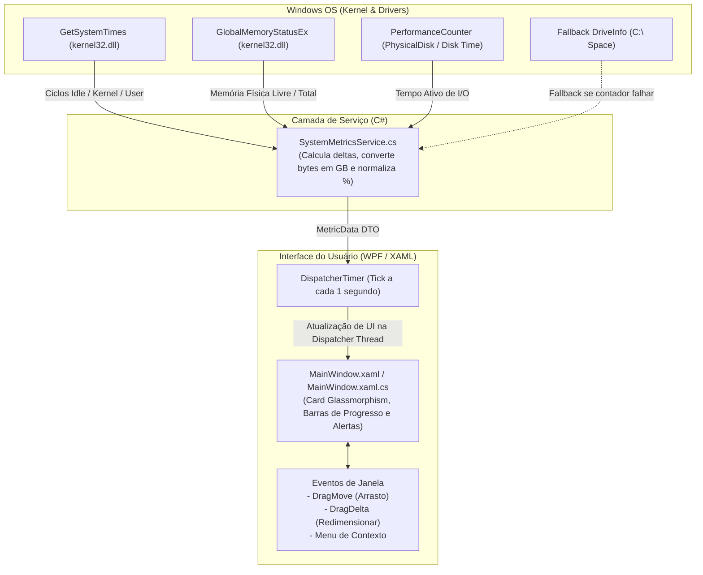

# ⚡ ZPulse - Floating Windows Resource Monitor Widget

Um widget flutuante moderno, minimalista e de alta performance para Windows que monitora **CPU**, **Memória RAM** e **Atividade de Disco** em tempo real, inspirado no Gerenciador de Tarefas do Windows (*Task Manager*).


-512BD4?logo=dotnet)


---

## 📋 Sumário
- [Recursos Principais](#-recursos-principais)
- [Tecnologias Utilizadas e os "Porquês"](#-tecnologias-utilizadas-e-os-porquês)
- [Arquitetura do Sistema](#-arquitetura-do-sistema)
- [Estrutura de Arquivos](#-estrutura-de-arquivos)
- [Como Executar em Desenvolvimento](#-como-executar-em-desenvolvimento)
- [Como Gerar o Executável Único para Compartilhar](#-como-gerar-o-executável-único-para-compartilhar)
- [Guia de Utilização](#-guia-de-utilização)

---

## ✨ Recursos Principais

- 📏 **Dois Modos de Exibição (Layouts Inteligentes):**
  - **Modo Barra Compacta (Padrão):** Uma barra horizontal ultra-fina de apenas **46px de altura**, ideal para ficar no topo da tela ou na barra de títulos sem cobrir botões nem atrapalhar o uso de nenhuma aplicação.
  - **Modo Card Completo:** Visual vertical detalhado com subtextos (ex: memória exata em GB e detalhes de disco).
  - *Como alternar:* Basta dar **duplo clique** no widget ou clicar no botão de alternar (`◱` / `—`).
- 📌 **Always-on-Top:** Fica sempre visível sobre qualquer janela, IDE ou jogo (com opção de desativar).
- 🖐️ **Arrasto Livre (*Draggable*):** Clique em qualquer ponto da janela e arraste para o canto que desejar.
- 📐 **Redimensionável:** Ajuste largura e altura puxando o indicador no canto inferior direito (`◢`).
- 📊 **Métricas de Hardware em Tempo Real (atualizadas a cada 1 segundo):**
  - **CPU:** Percentual de uso instantâneo, com alertas dinâmicos de cor.
  - **Memória:** Percentual de carga física e valores exatos em GB consumidos vs. total da máquina.
  - **Disco:** Percentual de tempo ativo (*Active Time*) de I/O de disco.
- 🚨 **Thresholds Inteligentes de Cores:**
  - `Normal (< 70%)`: Cores frias elegantes (Azul para CPU, Roxo para RAM, Verde para Disco).
  - `Alerta (70% - 85%)`: Amarelo/Laranja avisando carga moderada/alta.
  - `Crítico (> 85%)`: Vermelho alertando gargalos iminentes.
- 🎨 **Visual Dark Glassmorphism:** Fundo translúcido com cantos arredondados e sombra suave projetada na área de trabalho.
- 🖱️ **Menu de Contexto Completo (Botão Direito):**
  - Alternar entre Modo Compacto e Modo Card.
  - Alternar fixação no topo (*Topmost*).
  - Controle de opacidade da janela (100%, 85%, 65%).
  - Atalho direto para abrir o Gerenciador de Tarefas nativo do Windows (`taskmgr.exe`).
  - Fechar a aplicação com segurança.

---

## 🛠️ Tecnologias Utilizadas e os "Porquês"

### 1. C# e .NET 8 (LTS) com WPF
- **Por que não Electron / Webview?**
  Um widget de monitoramento precisa ser invisível para o sistema em termos de consumo. Criar isso com Electron incluiria uma instância inteira do Chromium + Node.js, consumindo de 150 MB a 250 MB de memória RAM só para dizer quanta memória a máquina está usando. 
- **Por que C# com WPF?**
  O WPF (*Windows Presentation Foundation*) oferece integração nativa com a API de janelas do Windows com aceleração de hardware via DirectX. O ZPulse consome **menos de 20 MB de RAM**, consome praticamente 0% de CPU em segundo plano e inicia de forma instantânea.

### 2. Coleta de CPU Sincronizada com o Gerenciador de Tarefas
- **O desafio técnico no Windows 10 e 11:**
  Em processadores modernos (como Intel Core de 12ª/13ª/14ª geração com núcleos híbridos *P-cores* e *E-cores*), o Gerenciador de Tarefas do Windows não mede o tempo ocioso bruto (*wall-clock time*), mas sim a **Utilidade do Processador** (`% Processor Utility`), que pondera a frequência de clock dinâmica e o *turbo boost* em relação à frequência base.
- **A Solução Adotada:**
  - **Métrica Primária:** Conecta diretamente ao contador oficial do Windows (`Processor Information -> % Processor Utility`), exibindo exatamente o mesmo percentual visível na aba de Desempenho e Processos do Gerenciador de Tarefas.
  - **Fallback de Alta Fidelidade:** Caso os contadores estejam desabilitados no registro da máquina, o ZPulse chaveia automaticamente para a API Win32 `GetSystemTimes` (`kernel32.dll`), garantindo que o widget nunca fique sem métricas nem gere exceções.

### 3. Leitura de Memória via `GlobalMemoryStatusEx` (`kernel32.dll`)
- **Por que não `GC` ou `Environment`?**
  APIs padrão do .NET como `GC.GetTotalMemory()` informam apenas o consumo da aplicação atual. Para inspecionar toda a memória física do sistema operacional (total instalado vs. livre vs. percentual de carga), a chamada de sistema do Windows `GlobalMemoryStatusEx` é a mais rápida e segura.

### 4. Monitoramento de Disco Resiliente com Fallback
- **Por que essa abordagem híbrida?**
  O Windows expõe o contador de tempo de atividade física do disco (`% Disk Time`). O ZPulse tenta conectar a esse contador para reproduzir fielmente o que o Gerenciador de Tarefas exibe. Se os contadores estiverem desabilitados ou corrompidos na máquina do usuário, a aplicação não trava: ela ativa automaticamente um *fallback* gracioso para o volume principal (`C:\`), exibindo espaço ocupado e gigabytes livres.

### 5. Janela Frameless com `Thumb` Customizado
- **Por que um `Thumb` para redimensionamento?**
  Ao configurar uma janela WPF com `AllowsTransparency="True"` e `WindowStyle="None"` para criar o design de widget sem barra de título, o Windows desabilita as bordas padrões de redimensionamento do sistema operacional. O controle `Thumb` captura os eventos `DragDelta` com coordenadas relativas e redimensiona a janela de forma fluida e controlada (`MinWidth` e `MinHeight` pré-definidos).

### 6. Empacotamento em Arquivo Único (*Self-Contained Single-File Executable*)
- **Por que configurar o `ZPulse.csproj` com `PublishSingleFile` e `SelfContained`?**
  Garante que qualquer colega de equipe em um computador Windows x64 consiga usar o utilitário com duplo clique, sem precisar instalar o .NET SDK, o runtime ou configurar qualquer variável de ambiente.

---

## 🏗️ Arquitetura do Sistema



---

## 📁 Estrutura de Arquivos

| Arquivo / Pasta | Papel no Projeto |
| :--- | :--- |
| **`ZPulse.csproj`** | Configurações do projeto .NET 8, dependências WPF e regras de publicação em arquivo único (*Self-Contained*). |
| **`Assets/`** | Ícone oficial "Z-Wave" em Emerald Green de alta nitidez nos formatos `app_icon.png` (usado na UI) e `app_icon.ico` (embutido no binário .exe). |
| **`SystemMetricsService.cs`** | Serviço responsável por todas as chamadas P/Invoke para as APIs Win32 e contadores de sistema. |
| **`MainWindow.xaml`** | Interface visual XAML: paleta escura glassmorphism, barras de progresso, tipografia e menu de contexto. |
| **`MainWindow.xaml.cs`** | *Code-behind*: temporizador de 1s, manipulação de arrasto (`DragMove`), redimensionamento (`DragDelta`) e regras de cores. |
| **`App.xaml` / `App.xaml.cs`** | Ponto de entrada do aplicativo WPF. |
| **`.gitignore`** | Regras para ignorar diretórios de compilação temporária (`bin/`, `obj/`, `publish/`). |

---

## 🚀 Como Executar em Desenvolvimento

Certifique-se de que possui o [.NET 8 SDK](https://dotnet.microsoft.com/download) instalado.

1. Clone o repositório ou navegue até a pasta:
   ```powershell
   cd C:\@repos\zpulse
   ```

2. Execute o projeto diretamente:
   ```powershell
   dotnet run
   ```

---

## 📦 Como Gerar o Executável Único para Compartilhar

Para compilar um `.exe` 100% autônomo e portátil para enviar para seus colegas:

```powershell
dotnet publish -c Release -o ./publish
```

### O que acontece sob o capô:
1. O compilador gera o executável nativo direcionado para `win-x64`.
2. Todas as bibliotecas de runtime necessárias do .NET e do WPF são mescladas dentro do binário principal.
3. Informações de depuração são suprimidas para gerar o binário mais limpo possível.
4. O resultado final estará em `publish/ZPulse.exe` (um único arquivo de dois cliques!).

---

## 🏷️ Versionamento & CI/CD Automático no GitHub

O projeto conta com uma esteira de **CI/CD no GitHub Actions** (`.github/workflows/release.yml`) totalmente automatizada:

### Como funciona:
1. **Fonte Única da Verdade:** A versão é definida no `ZPulse.csproj` (`<Version>1.0.0</Version>`) e exibida dinamicamente no rodapé do modo Card (`v1.0.0`).
2. **Disparo por Tag Git:** Sempre que você criar e enviar uma tag começando com `v*` para o GitHub:
   ```powershell
   git tag v1.0.0
   git push origin v1.0.0
   ```
3. **Pipeline Automatizado:**
   - O GitHub Actions provisiona uma máquina Windows.
   - Restaura o .NET 8 e compila o `ZPulse.exe` standalone com a versão carimbada no executável.
   - Cria um arquivo `.zip` (`ZPulse-windows-x64.zip`).
   - Gera um **Changelog automático** com base nos commits e pull requests.
   - Publica uma **GitHub Release oficial** anexando o executável e o zip para qualquer pessoa baixar!

---

## 🎮 Guia de Utilização

- **Alternar Modo (Compacto vs. Card):** Dê um **duplo clique** em qualquer lugar do widget ou clique no botão de alternância (`◱` para expandir / `—` para encolher).
- **Mover o Widget:** Pressione o botão esquerdo do mouse sobre o widget e arraste para qualquer posição da tela.
- **Redimensionar:** Coloque o cursor do mouse sobre o canto inferior direito (`◢`) até o cursor mudar para o formato de seta diagonal e puxe para expandir ou encolher.
- **Fixar/Desfixar no Topo:** Clique no ícone do alfinete (`📌`) no cabeçalho ou alterne pelo menu de contexto.
- **Menu do Botão Direito:** Clique com o botão direito sobre qualquer parte do widget para acessar:
  - *Alternar Modo Compacto / Card*.
  - *Fixar no Topo (Always on Top)*.
  - *Ajustes de Opacidade* (100%, 85%, 65%).
  - *Atalho rápido para o Gerenciador de Tarefas* do Windows.
  - *Fechar o aplicativo*.
